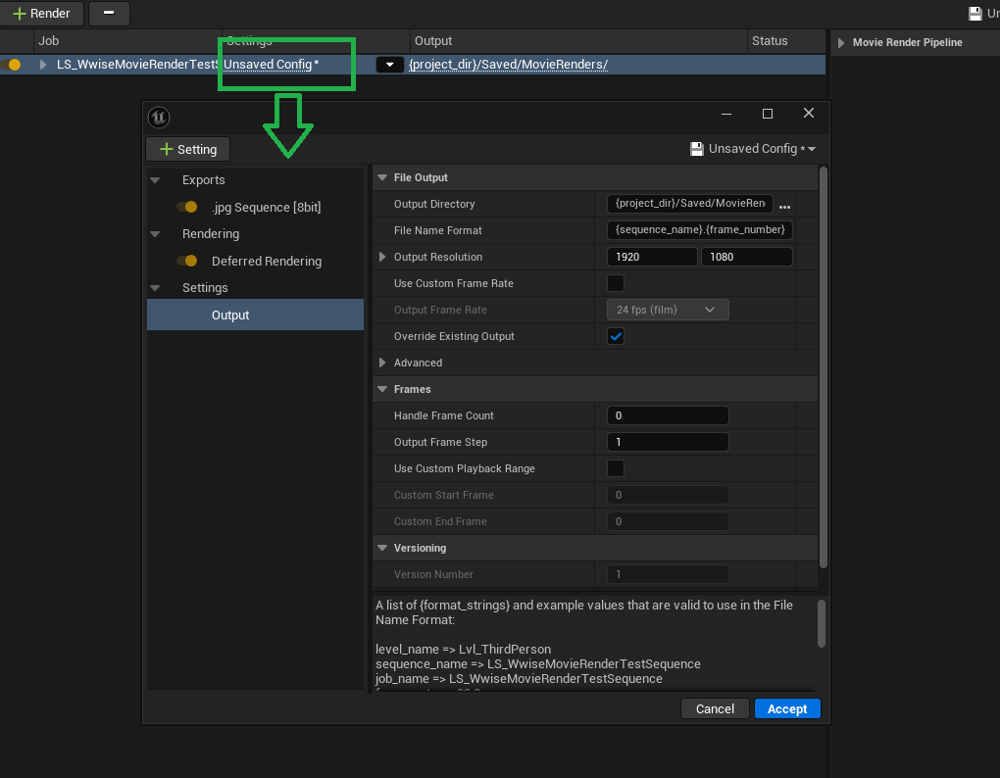
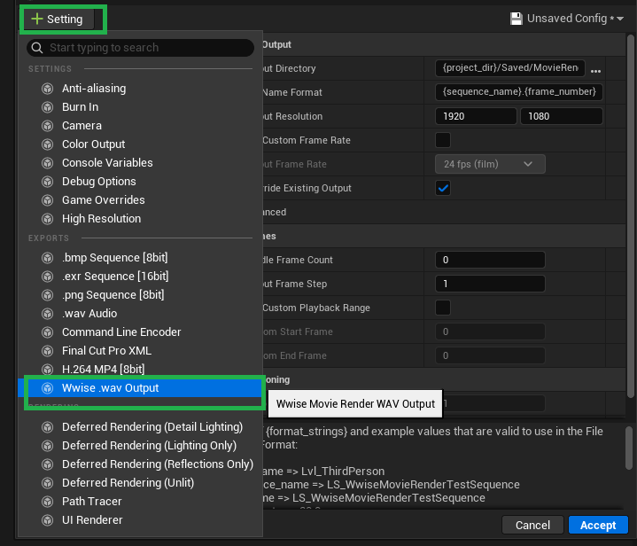
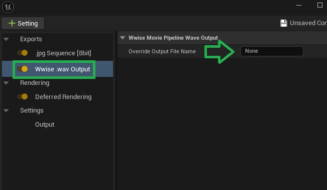

  

Wwise audio isn't rendered when Movie Render Queue renders a level sequence. This plugin adds an MRQ output node that captures every Wwise event playing during the render and writes it out as one finished `.wav` stem, sample-accurate with the picture.

## Requirements

* Unreal Engine 5
* The Wwise integration plugin, installed and initialized in your project
* Movie Render Queue enabled

## Installation

1. Clone this repository (or download the zip).
2. Copy the contents into your project's `Plugins/WwiseMovieRenderOutput` folder.
3. Enable **WwiseMovieRenderOutput** in the Plugins browser and restart the editor if prompted.

## Usage

**1. Open MRQ and edit the render config. Make sure Deferred Rendering is present under Rendering or add if necessary.**

**2. Add the "Wwise .wav Output" setting.**

**3. Optionally override the output filename.** By default the stem is named after the first rendered video frame, dropped in the same output directory as the rest of the render.

## How it works

MRQ ticks the render one frame at a time, and the plugin's output node rides along: on each frame it tells Wwise's sound engine to render exactly that frame's worth of audio in offline mode, captures the returned buffer, and appends it as 24-bit PCM. When the render finishes, the accumulated buffer is written out as a single WAV file, keeping the audio locked to the same frame clock as the video.

## License

MIT — see [LICENSE](LICENSE).
